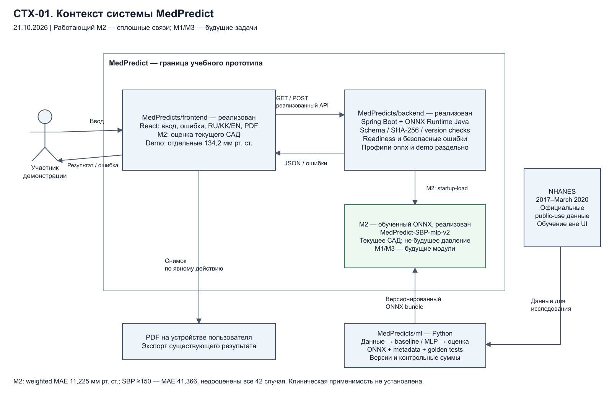

# MedPredict ML-AI

## Название и краткое описание

**MedPredict** — учебный исследовательский проект «Разработка интеллектуальной системы прогнозирования медицинских показателей на основе нейронных сетей». ML-AI — его часть для подготовки данных, сравнения базовых методов и нейросетей, анализа ошибок и подготовки модельных артефактов. Проект выполняется в Astana IT University, Software Engineering, группа SE-2409.

Репозиторий содержит **исполняемый воспроизводимый pipeline M2** (`src/medpredict_ml`), закреплённые зависимости, конфигурацию эксперимента, тесты, агрегированные отчёты, model card и ONNX bundle `MedPredict-SBP-mlp-v2`, который загружает backend в профиле `onnx`. Сырые и подготовленные строки NHANES, построчные прогнозы, split manifest и локальные checkpoints (`.pt`, `.joblib`) в Git не входят: данные скачиваются из CDC командой `download`, checkpoints восстанавливаются обучением.

[Документация проекта](https://github.com/MedPredicts/documentation#readme) · [Frontend](https://github.com/MedPredicts/frontend#readme) · [Backend](https://github.com/MedPredicts/backend#readme) · [Индекс схем](docs/architecture/diagrams/README.md)

## Проблема, целевые пользователи и ожидаемые результаты

При исследовании медицинских показателей важно сохранять смысл целевой переменной, единицы, порядок признаков и предобработку от эксперимента до интерфейса. Наличие нейросети само по себе не доказывает преимущество перед простым baseline, пригодность для другой популяции или надёжность отдельного ответа. MedPredict исследует эти вопросы через воспроизводимое сравнение и явное описание ограничений.

Целевые пользователи текущего исследовательского объёма — студенты, исследователи и разработчики, проверяющие ML-эксперименты и их интеграцию в учебной демонстрации. Применение пациентами для самостоятельной диагностики или лечения не входит в этот объём; пользовательская и клиническая полезность не считаются установленными.

Ожидаемые результаты ML-части: паспорта задач и данных, фиксированные протоколы и разбиения, сравнение baseline и нейросетей, анализ ошибок, версионированные артефакты и проверка численного соответствия при интеграции. Технически корректный отрицательный результат или обоснованный отказ от неподходящих данных также сохраняется как результат исследования. Фактическая готовность модулей приведена ниже.

## Команда, обязанности и научный руководитель

| Участник | Направление | Обязанности |
|---|---|---|
| **Бөгенбаев Санат** | Frontend и UI/UX | Пользовательские сценарии, React/TypeScript, локализация, форма по метаданным, отображение результата, PDF и проверки интерфейса |
| **Баймен Али** | Данные и машинное обучение | Постановка задач, источники и признаки, протоколы, baseline/нейросетевые эксперименты, оценка ошибок и ограничения результатов |
| **Сеилхан Оралхан** | Backend и интеграция | Java/Spring Boot API, серверная валидация и ошибки, совместимость метаданных и модельного артефакта, численное соответствие и интеграционные проверки |

**Научный руководитель — Турарова Маржан Кабдыкалиевна.** ФИО предоставлено командой. Эта информация не является свидетельством формального утверждения, полученного отзыва или одобрения конкретной версии. Распределение обязанностей также не заменяет свидетельства личного вклада и peer review.

## Границы проекта и текущий статус

Локальная ML-часть предназначена для подготовки данных, offline-обучения, сравнения базовых методов и нейросетей, анализа ошибок и экспорта M2. Она не является отдельным HTTP inference-сервисом и не обучается на запросах пользователей.

M2 опубликован в этом репозитории; материалы M1 и M3 пока остаются локальными. 22 ноября 2026 года M2 воспроизведён из чистого скачивания CDC в отдельном workspace на macOS arm64 / Python 3.12: test-метрики всех четырёх моделей совпали с сохранёнными (MLP weighted MAE 11,2254, Ridge 11,2680), различались только замеры задержки. Байтовое совпадение ONNX не заявляется.

| Модуль | Состояние | Граница результата |
|---|---|---|
| **M1 — прогрессирование Diabetes через год** | Offline benchmark mean / Ridge / MLP выполнен 23 октября; по development выбран Ridge alpha=10, final MAE 39,466 | Шкала target датасета, не вероятность диабета и не глюкоза. Убедительное превосходство MLP не установлено. Формы, API и ONNX-интеграция M1 не выпущены |
| **M2 — текущее систолическое давление** | Опубликованы NHANES pipeline, сравнение baseline / MLP, отчёты и ONNX bundle; полный прогон воспроизведён из чистого скачивания | Исследовательская оценка текущего САД. Внешняя проверка NHANES 2021–2023 (n = 2 680): weighted MAE 10,52; 90% conformal-интервал, покрытие 91,3% (26% при САД ≥150). Клиническая валидация не подтверждена |
| **M3 — будущая сенсорная глюкоза** | Паспорт и аудит CGMacros подготовлены; **NO_GO** для исходной causal forecast-задачи | Происхождение нативных измерений и timestamps не подтверждено; минутные интерполированные ряды нельзя автоматически считать исходными CGM-измерениями. Модель не обучена |

### Состав репозитория

```text
src/medpredict_ml/   download → prepare → train → evaluate → export → verify
configs/             experiment.json (seeds, сетка, доли split)
tests/               pytest: чтение XPT, модель, обучение/экспорт
artifacts/           model.onnx, metadata.json, golden.json, selection.json
reports/             аудит данных, протокол, validation/test, ONNX/Java parity, figures/
docs/                выбор данных, протокол, результаты, model card, research summary
integration/         как backend загружает bundle
docs/architecture/   схемы (PNG + drawio)
```

Сырые медицинские строки, идентификаторы участников (`SEQN`), split manifest и индивидуальные прогнозы в Git не включены (`.gitignore`). Отчёты содержат только агрегированные показатели.

### Архитектура

Схемы сохранены без изменения PNG или редактируемого XML из архитектурных материалов frontend. Они датированы **21 октября 2026 года** и показывают отдельную **локальную интеграцию M2**: offline Python → bundle → Java ONNX → проверенный ответ → React / PDF. ONNX-провайдер находится в [`../backend`](../backend) этого монорепозитория и проверен на этом bundle (48 тестов, расхождение Python/Java ≤ 7,6·10⁻⁶ мм рт. ст.).

Отметки M1/M3 как будущих модулей относятся к этому историческому срезу приложения. Более поздний M1 benchmark остаётся offline-работой, а не подключённым модулем; текущее состояние приведено в таблице выше. Упоминание `MedPredicts/ml` внутри схем — историческое название ML-части, а не свидетельство публикации её кода в этой версии `ml-ai`.

| Обязательная схема | Просмотр | Редактируемый источник |
|---|---|---|
| Контекст системы | [PNG](docs/architecture/diagrams/context.png) | [drawio](docs/architecture/diagrams/context.drawio) |
| Варианты использования | [PNG](docs/architecture/diagrams/use-cases.png) | [drawio](docs/architecture/diagrams/use-cases.drawio) |
| Компоненты | [PNG](docs/architecture/diagrams/components.png) | [drawio](docs/architecture/diagrams/components.drawio) |



[Полный индекс и границы схем](docs/architecture/diagrams/README.md). PNG предназначены для просмотра; `.drawio` содержат редактируемые исходники diagrams.net.

### Локальный эксперимент M2 и ограничения

M2 использует публичные исследовательские данные **CDC/NCHS NHANES 2017–March 2020 pre-pandemic**. Target — среднее минимум двух валидных измерений САД при одном обследовании. Пять входов: возраст, пол, ИМТ, общий холестерин и **глюкоза плазмы натощак**. Оценка относится к текущему измеряемому САД; это не фактическое измерение пациента и не прогноз будущего давления.

Локальный исправленный v2 включает 3 318 участников: 2 324 train / 497 validation / 497 test. Масштабирование обучено только на train; конфигурация выбрана по validation. У MLP `5 → 32 → 16 → 1` weighted test MAE — **11,225 мм рт. ст.**, у Ridge — **11,268**. Разница около 0,043 не устанавливает убедительного превосходства нейросети. При фактическом САД ≥150 все 42 тестовых результата занижены; weighted MAE группы — **41,366 мм рт. ст.**

v1 отозван после ошибки декодирования нулевых fasting-весов XPT. В v2 использован исправленный reader, однако прежний test уже был просмотрен: результат является внутренним пересчётом после исправления данных, а не полностью нетронутой или внешней валидацией. Средняя MAE не является интервалом отдельного ответа. Условия исходных public-use данных описаны в [NCHS Data User Agreement](https://www.cdc.gov/nchs/policy/data-user-agreement.html); лицензии библиотек не определяют условия использования датасета.

**Исследовательский прототип не предназначен для диагностики, лечения или изменения лекарств, не заменяет тонометр и не имеет подтверждённой клинической валидации для Казахстана.** Численная проверка Python / ONNX / Java и корректность программного интерфейса не устанавливают медицинскую пригодность. Фиксированный demo 134,2 мм рт. ст. является отдельным примером, а не результатом обученной модели.

## Выбранные технологии

Версии закреплены в [pyproject.toml](pyproject.toml) и [requirements.lock](requirements.lock).

| Технология | Назначение и выбор |
|---|---|
| **Python 3.11–3.13** | Поддерживаемый диапазон исследовательского пакета; offline-подготовка, обучение, оценка и экспорт |
| **PyTorch 2.9.1** | Собственные компактные MLP и обучение их весов; использование библиотеки не заявляется как новая архитектура |
| **scikit-learn 1.7.2** | Базовые методы, Ridge, HistGradientBoosting и сопоставление с нейросетью по общему протоколу |
| **ONNX 1.19.1 / ONNX Runtime 1.23.2** | Экспорт и Python-проверка M2 с предобработкой внутри графа; Java ONNX Runtime относится к отдельному backend |
| **NumPy / pandas / pyreadstat** | Численные операции, объединение таблиц и исправленное чтение NHANES XPT; версии зафиксированы в `requirements.lock` |

ML-часть не предоставляет собственного HTTP API. React/TypeScript/Vite и Java/Spring Boot относятся соответственно к отдельным frontend и backend. Поддержка ONNX для M2 не означает выпущенный ONNX/API-модуль M1 или M3.

## Ссылки на Jira и документацию

- [Jira MED — действующая доска проекта](https://medpredict.atlassian.net/jira/software/projects/MED/boards/2?filter=&groupBy=none): задачи, исполнители, приоритеты и наблюдаемый статус. Использование Jira подтверждено командой; старые ссылки и идентификаторы YouTrack относятся к историческому процессу.
- [Документация MedPredict](https://github.com/MedPredicts/documentation#readme): предложение, требования, исследования, архитектура и план работ.
- [Frontend](https://github.com/MedPredicts/frontend#readme): форма, отображение ответа и PDF.
- [Backend](https://github.com/MedPredicts/backend#readme): Java HTTP API.
- [Архитектурные схемы этого снимка](docs/architecture/diagrams/README.md): PNG и редактируемые `.drawio`.

Перед сквозным запуском необходимо сверить конкретные версии frontend, backend и модели: backend проверяет `modelVersion` и SHA-256 из `artifacts/metadata.json` при старте.

## Установка, запуск и тестирование

Нужны Python 3.11–3.13 и CPU. Проверено на Python 3.12, macOS arm64.

```sh
git clone https://github.com/MedPredicts/ml-ai.git
cd ml-ai
python3.12 -m venv .venv
.venv/bin/python -m pip install -r requirements.lock
.venv/bin/python -m pip install --no-deps -e .
.venv/bin/python -m pytest --cov=medpredict_ml --cov-report=term-missing
```

Сохранённый эксперимент закрыт для повторного обучения: [reports/test_opened.json](reports/test_opened.json) фиксирует однократное открытие test. Воспроизведение выполняется в **новом** каталоге; все шесть команд используют один `--workspace`:

```sh
W=/tmp/medpredict-reproduction
for step in download prepare train evaluate export verify; do
  .venv/bin/python -m medpredict_ml "$step" --workspace "$W"
done
```

Если `download` падает с `CERTIFICATE_VERIFY_FAILED` (Python с python.org на macOS), задайте `export SSL_CERT_FILE=/etc/ssl/cert.pem` или запустите `Install Certificates.command`.

Внешняя проверка на NHANES 2021–2023 и conformal-интервал (протокол v3): команды `download-external`, `evaluate-external`, `package-interval`; результаты и порядок запуска — в [docs/external-validation-v3.md](docs/external-validation-v3.md).

Не удаляйте блокировку test ради подбора гиперпараметров: новая постановка требует нового эксперимента и, желательно, новой независимой когорты. Подключение bundle к backend: [integration/README.md](integration/README.md). Подробности данных, предобработки и исправления XPT — в [docs/](docs/) и [model card](docs/model-card.md).
